# AGRIFLOW-AI — Application Technical Flow

**Purpose:** Single reference for how requests, data, and domain events move through the platform (Phases 1–15).  
**Audience:** Engineers onboarding, interview prep, and runtime validation.  
**Related:** [02-architecture.md](./02-architecture.md), [09-architecture-diagrams.md](./09-architecture-diagrams.md), [phase-implementations/frontend-ui.md](./phase-implementations/frontend-ui.md)

---

## 1. System at a glance

AGRIFLOW-AI is a **layered FastAPI backend** plus a **React SPA**. Operational data lives in **PostgreSQL 17**; time-series domains use **TimescaleDB** hypertables. Phases 13–15 add **decision records**, a **transactional event outbox**, and **intelligence projections** (Feature Store, CQRS read models, Digital Twin state).

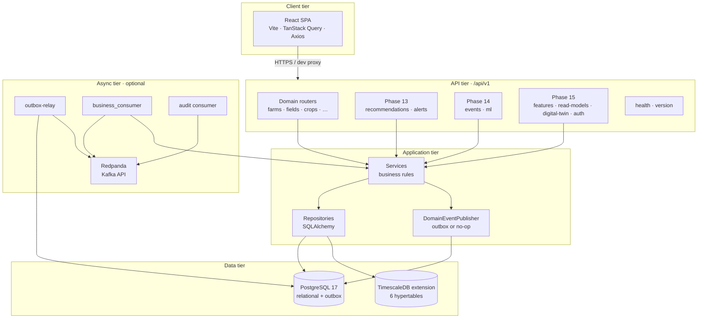

| Tier | Responsibility |
|------|----------------|
| **Client** | Pages, forms, dashboards; JWT in `localStorage` for operator APIs |
| **API** | HTTP contracts (Pydantic), auth dependencies, thin routing |
| **Application** | Agronomic rules, orchestration, event publication |
| **Data** | ACID transactions, hypertable analytics, outbox durability |
| **Async** | At-least-once delivery when `REDPANDA_ENABLED=true` and workers run |

---

## 2. Synchronous request path (typical CRUD)

Every mutating API call follows the same **request → service → repository → database** path. One HTTP request maps to **one database transaction** via `get_session()` in `backend/app/api/deps.py`.

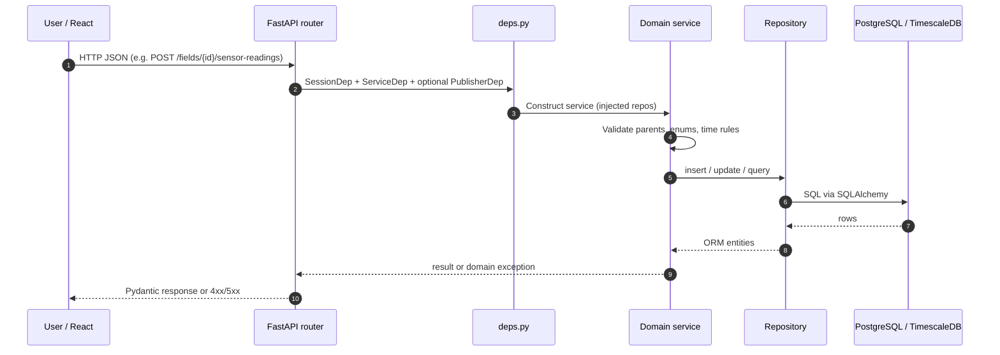

**Example trace — create sensor reading**

| Step | Component | Artifact |
|------|-----------|----------|
| UI action | `Sensors.tsx` | Form submit |
| HTTP | `POST /api/v1/fields/{field_id}/sensor-readings` | `SensorReadingServiceDep` |
| Service | `app/services/sensor_reading.py` | Immutability, field exists, `recorded_at` rules |
| Persistence | `SensorReadingRepository` | `sensor_readings` hypertable |
| Side effect | `OutboxDomainEventPublisher` | `SensorReadingCreated` → `domain_event_outbox` (if `EVENTS_ENABLED`) |

---

## 3. Backend layering (Clean Architecture)

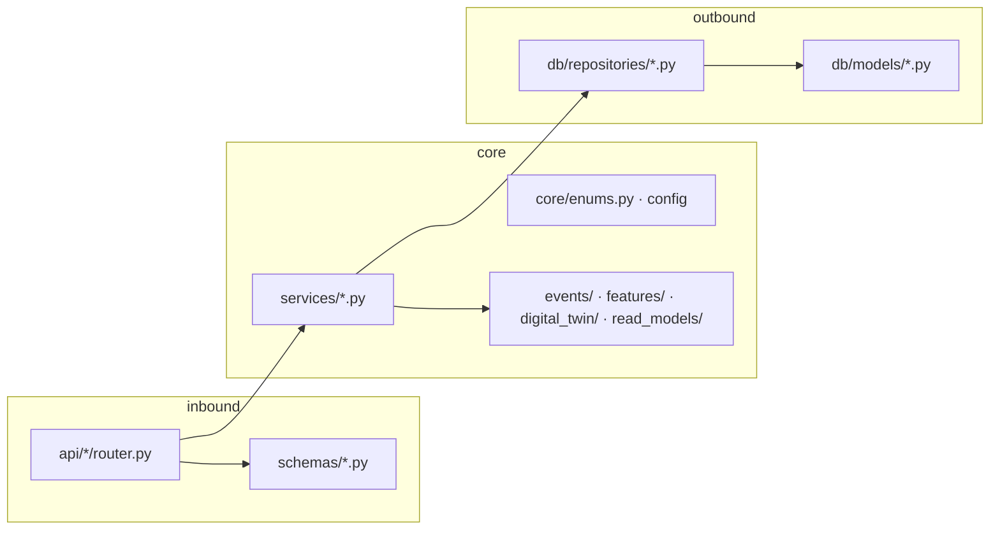

**Rules of thumb**

- Routers do not embed SQL.
- Services raise domain-friendly errors; routers map them to HTTP status codes.
- Cross-cutting intelligence (Feature Store, projections, twin documents) lives in dedicated packages under `app/`, invoked from services or event handlers.

---

## 4. Phase 13 — Decision intelligence flow

Recommendations and alerts are **first-class relational rows**, not chat messages. The UI reads them through field-scoped list APIs; acknowledgement and status changes use `PATCH`.

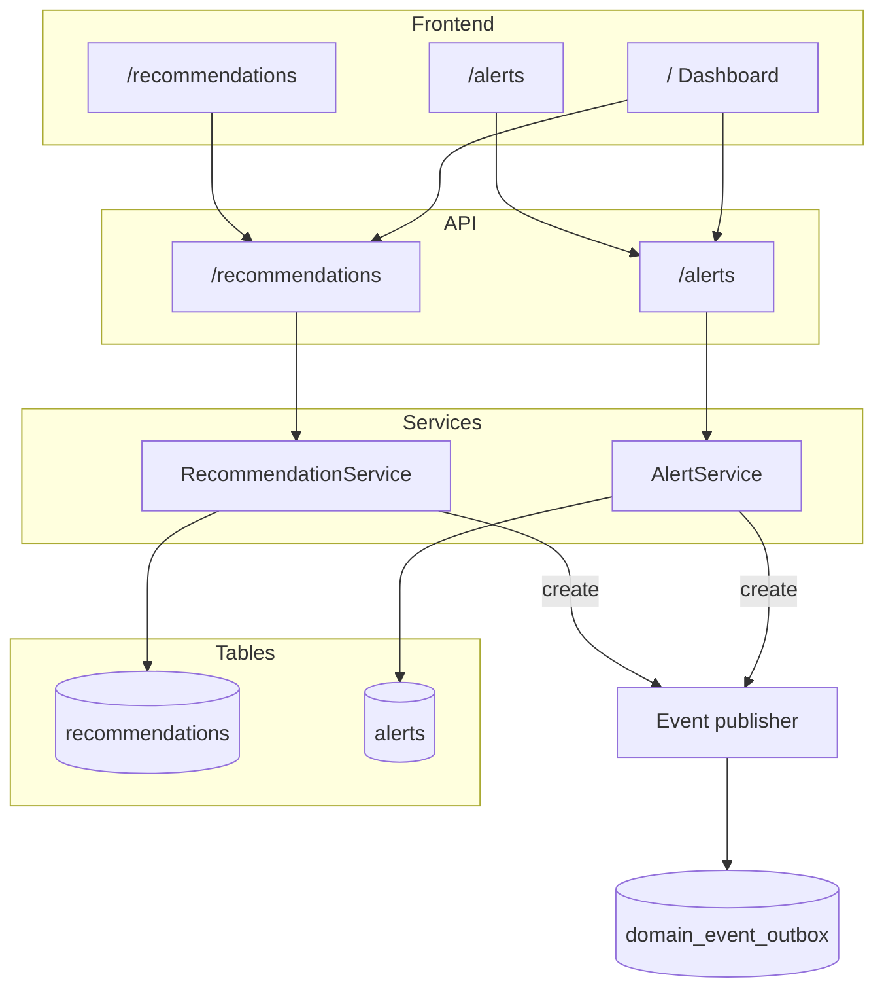

| Concept | Where it lives |
|---------|----------------|
| Recommendation lifecycle | `RecommendationStatus`, `engine_version`, `confidence_score` |
| Alert lifecycle | `AlertSeverity`, `is_acknowledged`, optional `recommendation_id` |
| Farm CRUD | `/api/v1/farms` (completed Phase 13) |

---

## 5. Phase 14 — Domain events and outbox

When `EVENTS_ENABLED=true`, domain writes enqueue an **outbox row in the same transaction** as the business change. Publishing to Redpanda is asynchronous via the relay worker.

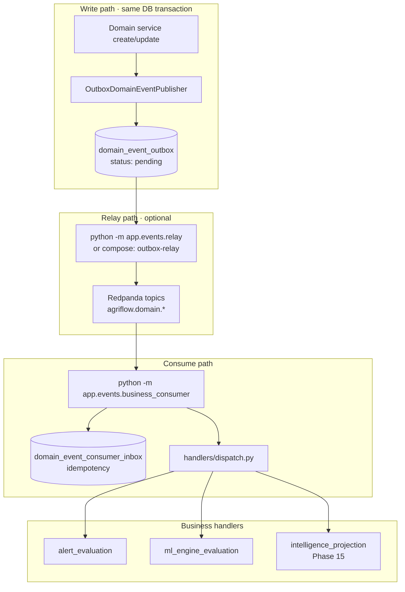

**Dispatch fan-out** (`app/events/handlers/dispatch.py`):

1. **alert_evaluation** — e.g. low soil moisture → `Alert` (with dedup rules for open alerts).  
2. **ml_engine_evaluation** — stub engines when `ML_ENGINE_AUTO_RUN_ENABLED=true`.  
3. **intelligence_projection** — Phase 15 snapshot + read model + twin sync when `INTELLIGENCE_EVENT_PROJECTION_ENABLED=true`.

**Monitoring UI:** `GET /api/v1/events/catalog`, `GET /api/v1/events/outbox/stats`, `GET /api/v1/events/outbox/entries` — React `/events`. Operator auth: `PlatformOperatorDep` (JWT and/or `X-Events-Ops-Key`).

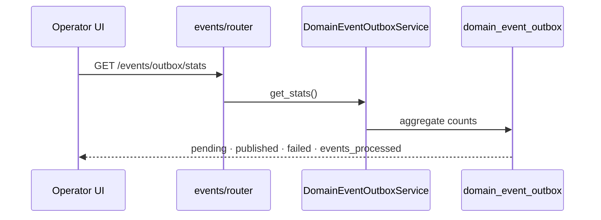

---

## 6. Phase 15 — Intelligence platform flow

Phase 15 adds **governed features**, **dashboard projections**, **twin state**, and **operator JWT**. Work can be triggered by **HTTP (operator)** or **domain events (async)**.

### 6.1 Feature Store (materialise)

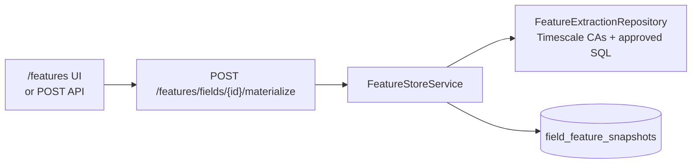

- Catalog (read-only): `GET /api/v1/features/catalog`  
- Latest snapshot: `GET /api/v1/features/fields/{id}/snapshots/latest`

### 6.2 CQRS dashboard read models

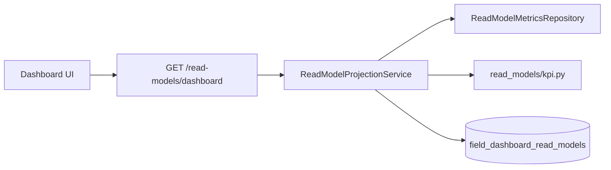

- **Auto-refresh on read** when `READ_MODEL_AUTO_REFRESH_ON_READ=true` (service may refresh before return).  
- **Manual refresh:** `POST /read-models/dashboard/refresh` (and farm/field variants) — operator-only; no dedicated React page yet.

### 6.3 Digital Twin (foundation)

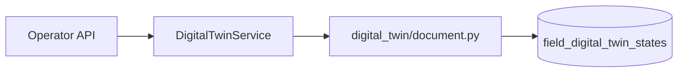

- `GET /api/v1/digital-twin/fields/{id}/state`  
- `POST /api/v1/digital-twin/fields/{id}/synchronize` — protected by `PlatformOperatorDep`

### 6.4 Event-driven intelligence projection

On **field-scoped** events, one handler chains three steps (`app/events/handlers/intelligence_projection.py`):

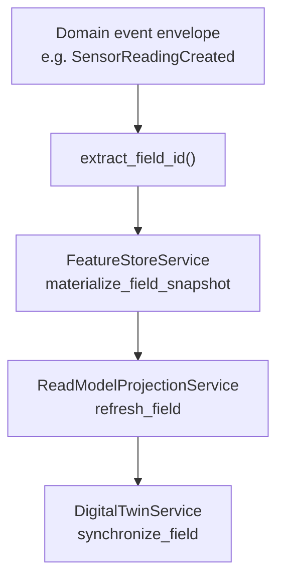

---

## 7. Authentication flow (Phase 15 operators)

Platform login is for **operator** APIs (materialise, refresh, twin sync, outbox ops). Farm/field CRUD remains open in development when `AUTH_REQUIRED=false`.

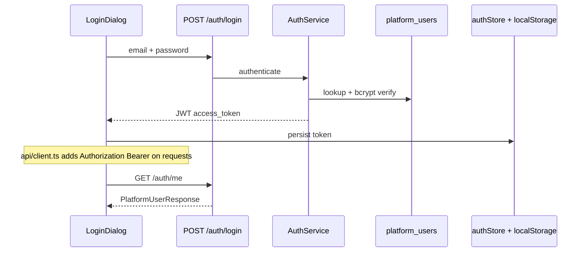

| Role | Typical use |
|------|-------------|
| `OPERATOR` / `ADMIN` | Materialise, refresh, twin sync, outbox |
| `VIEWER` | Defined in schema; limited separate UI today |
| Dev bypass | `AUTH_REQUIRED=false` + `APP_ENV=development` → synthetic principal |

Bootstrap user created by migration `n8o9p0q1r2s3` — see `backend/.env.example` (rotate in production).

---

## 8. Frontend route → API map (summary)

| User journey | Route | Primary backend prefix |
|--------------|-------|-------------------------|
| Platform KPIs | `/` | `/read-models/dashboard`, farms, alerts, recommendations |
| Farm operations | `/farms` … `/satellite` | `/farms`, `/fields`, domain routers |
| Decisions | `/recommendations`, `/alerts` | `/recommendations`, `/alerts` |
| Events ops | `/events` | `/events/catalog`, `/events/outbox/*` |
| Feature Store | `/features` | `/features/*` |
| Sign-in | Header | `/auth/login`, `/auth/me` |

Full table: [phase-implementations/frontend-ui.md](./phase-implementations/frontend-ui.md).

---

## 9. Data stores touched by phase

| Phase | Primary tables / objects |
|-------|---------------------------|
| 1–11 | `farms`, `fields`, `crops`, `soil_profiles`, hypertables (`sensor_readings`, `weather_records`, …) |
| 12 | Timescale policies, continuous aggregates (DB objects, not app tables) |
| 13 | `recommendations`, `alerts` |
| 14 | `domain_event_outbox`, `domain_event_consumer_inbox` |
| 15 | `field_feature_snapshots`, `field_dashboard_read_models`, `field_digital_twin_states`, `platform_users` |

---

## 10. Local runtime composition

For **full** Phase 14 async behavior, run database + Redpanda + backend + relay + consumers (see root `docker-compose.yml`). For **API-only** dev, TimescaleDB + host `uvicorn` + host `npm run dev` is enough; set `REDPANDA_ENABLED=false` and rely on outbox rows until relay is started.

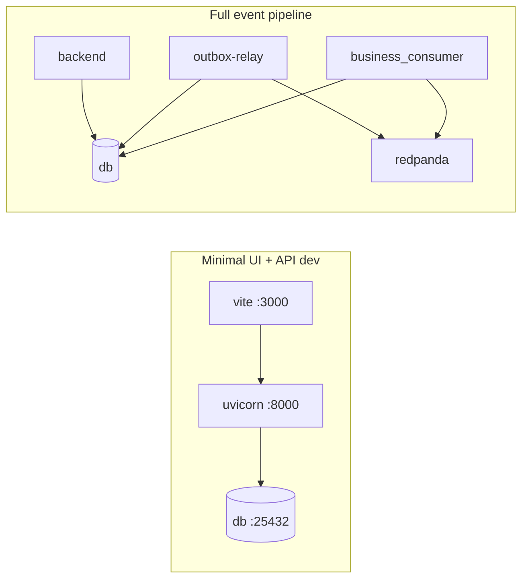

---

## 11. What this document does not cover

- **Phase 16** (Farm Copilot, Temporal, production ML training, full test/CI matrix) — see [06-roadmap.md](./06-roadmap.md).  
- **CDD bulk seeding** — engineering utility under `backend/app/cdd/` (not part of the online request path).  
- **Per-field authorization / multi-tenant** — data model is farm-scoped; enterprise IAM is future work.

---

## 12. Quick reference — key file paths

| Concern | Path |
|---------|------|
| API aggregation | `backend/app/api/router.py` |
| DI / sessions | `backend/app/api/deps.py` |
| Operator auth | `backend/app/core/security/platform_auth.py` |
| Outbox publish | `backend/app/events/publisher.py` |
| Event dispatch | `backend/app/events/handlers/dispatch.py` |
| Intelligence projection | `backend/app/events/handlers/intelligence_projection.py` |
| Feature Store | `backend/app/services/feature_store.py` |
| Read models | `backend/app/services/read_model_projection.py` |
| Digital Twin | `backend/app/services/digital_twin.py` |
| HTTP client + JWT | `frontend/src/api/client.ts` |
| App routes | `frontend/src/App.tsx` |

---

*Last aligned with Phases 13–15 implementation references and `main` branch architecture.*
